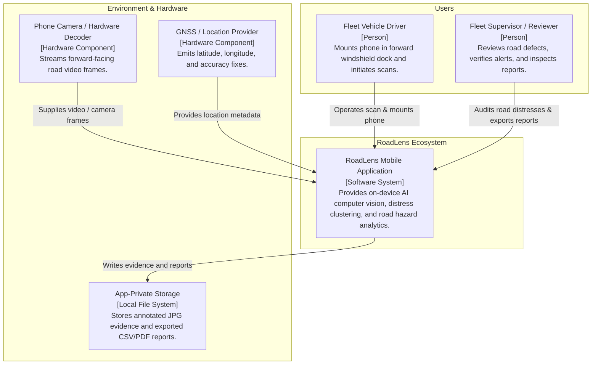
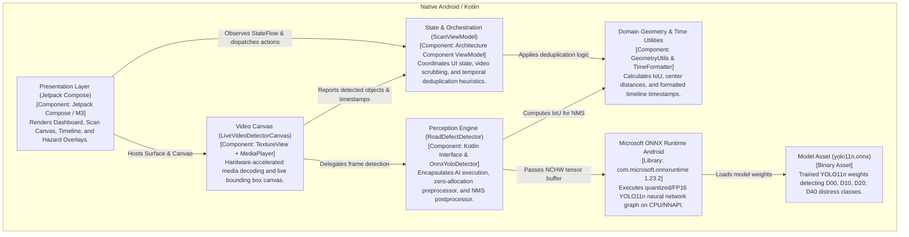

# RoadLens – C4 Architecture Models (KPI 2.2)

This document specifies the C4 Level 1 (System Context) and Level 2 (Container) architectural models for RoadLens.

---

## 1. C4 Level 1: System Context Diagram

The System Context diagram describes RoadLens in relation to its users, physical vehicle hardware, and external environments. RoadLens is designed as a **local-first, privacy-preserving on-device intelligence system** that functions completely without mandatory internet or cloud dependencies.

---

## 2. C4 Level 2: Container Diagram

The Container diagram illustrates the high-level technical architecture of the RoadLens Android application container.

