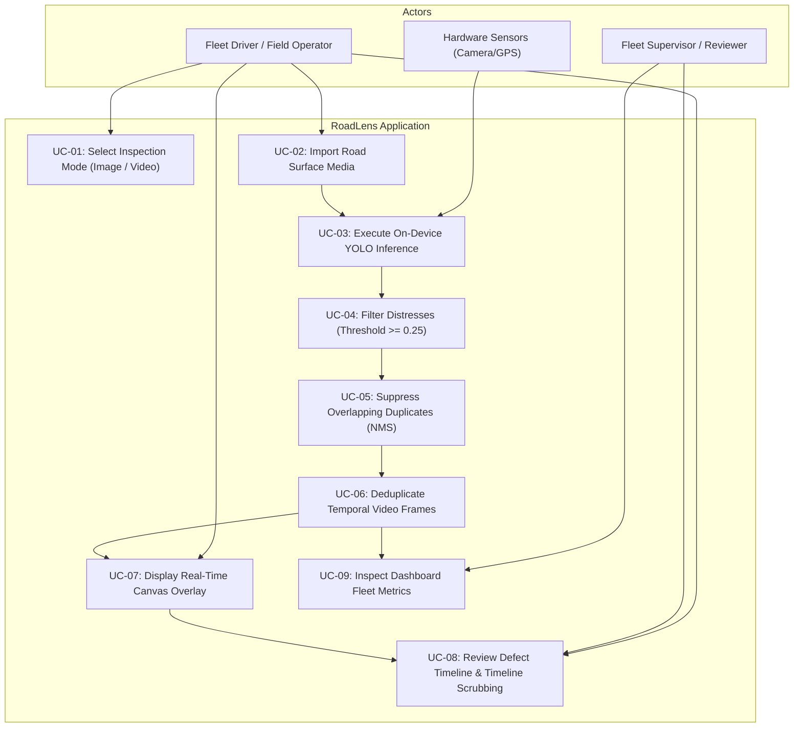
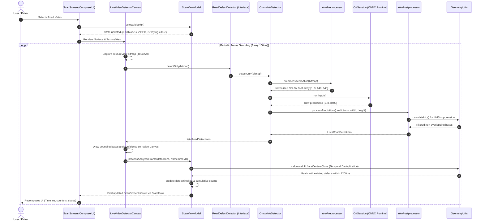

# RoadLens – UML Architecture Diagrams (KPI 2.1)

This document contains the official UML Use-Case and Sequence Diagrams representing the implemented functionality of RoadLens, adhering strictly to KPI 2.1.

---

## 1. UML Use-Case Diagram

The use-case diagram illustrates the interactions between primary actors (Fleet Driver / Operator, Fleet Supervisor / Reviewer, System Clock / Hardware Sensors) and the RoadLens application.

---

## 2. UML Sequence Diagram: Video Defect Detection & Deduplication Pipeline

This sequence diagram depicts the end-to-end execution flow of real-time road distress perception from video playback to state update and UI overlay.

